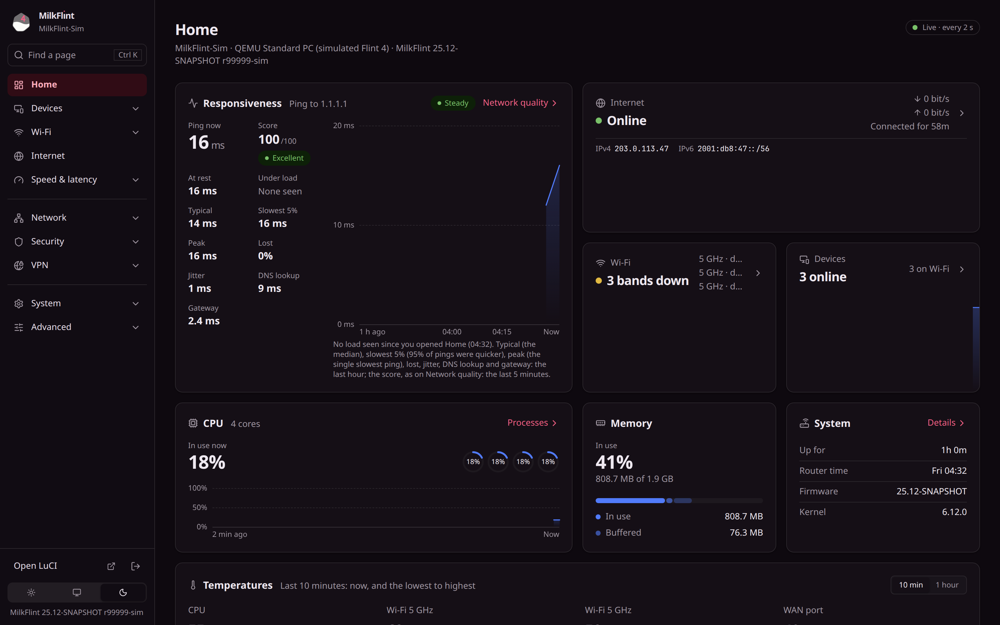
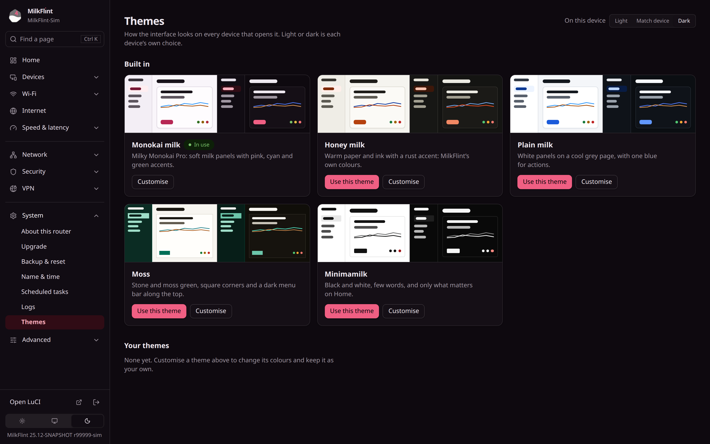
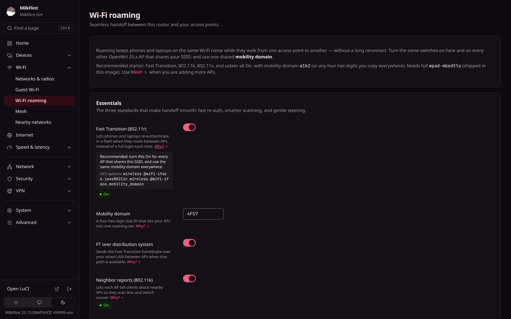
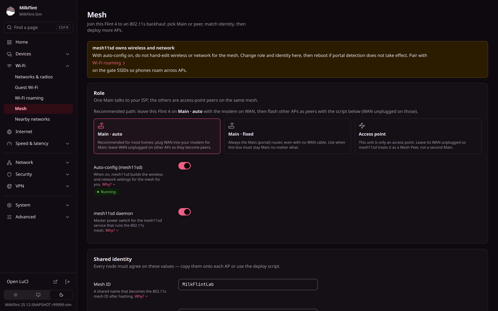
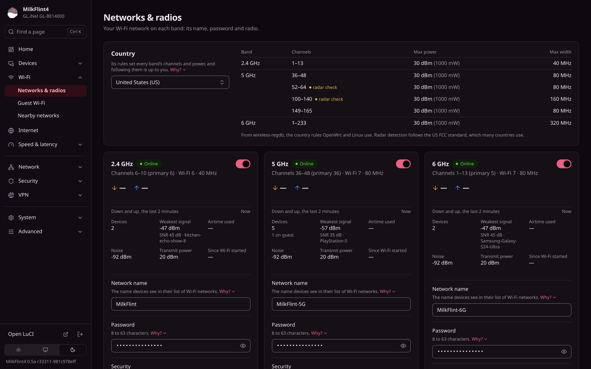
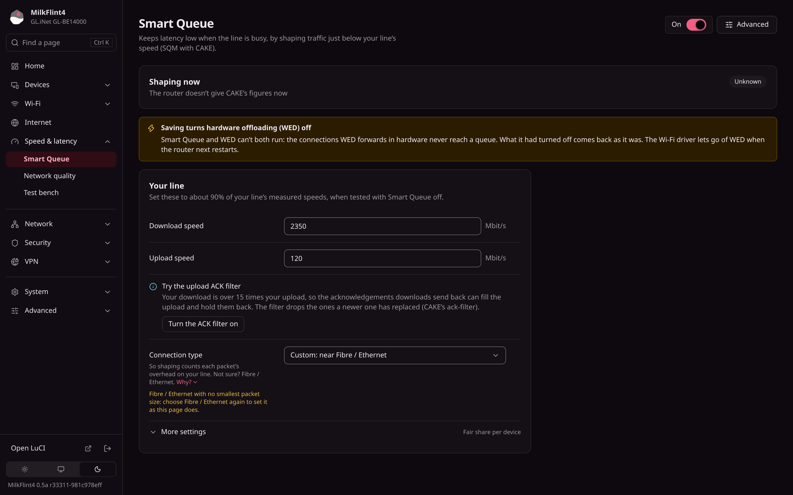
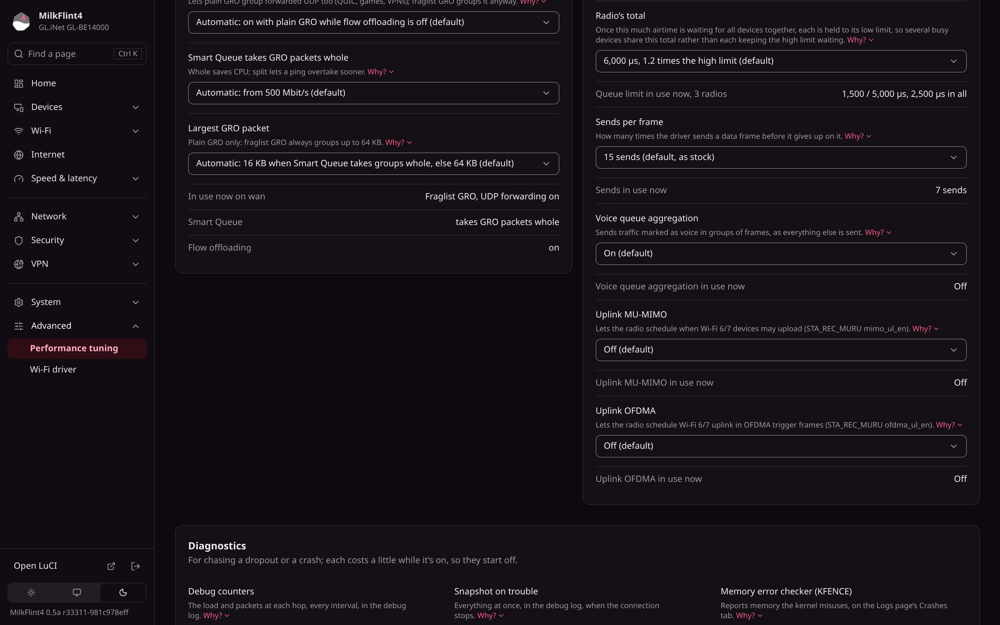
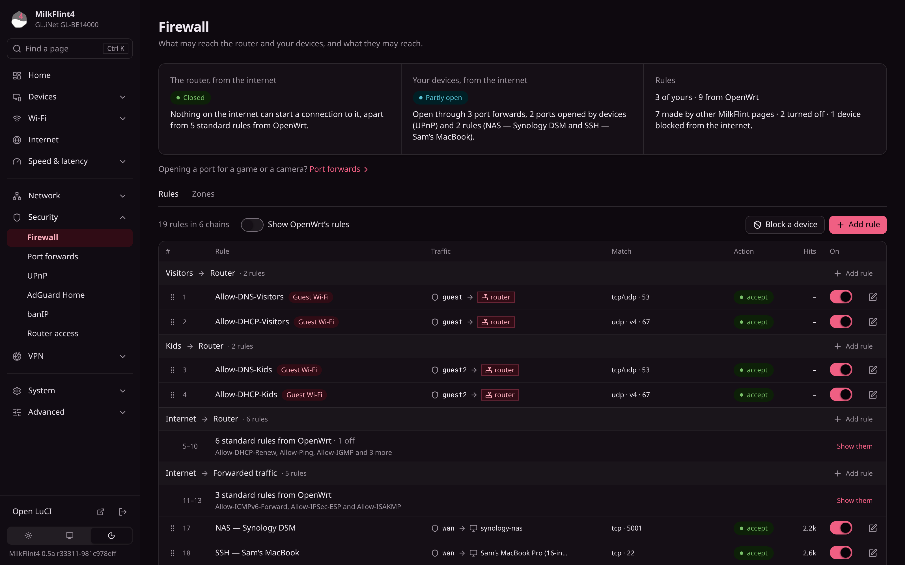

<p align="center">
  
</p>

<h1 align="center">MilkFlint4</h1>

<p align="center">
  <strong>OpenWrt that actually <em>feels</em> like a Flint 4</strong><br>
  <code>GL-BE14000</code> · MT7988A · <strong>kernel 6.18</strong> · Wi‑Fi 7 · 10G WAN · LCD that isn’t a blank stare
</p>

<p align="center">
  <a href="https://github.com/REFFIXX/MilkFlint4/releases"></a>
  <a href="https://github.com/REFFIXX/MilkFlint4/releases"></a>
  <a href="https://github.com/REFFIXX/MilkFlint4/releases"></a>
  <a href="https://github.com/REFFIXX/MilkFlint4/releases"></a>
  <a href="https://github.com/REFFIXX/MilkFlint4/releases"></a>
  <a href="https://github.com/REFFIXX/MilkFlint4/releases"></a>
  <a href="https://openwrt.org"></a>
</p>

---

If you’ve been waiting for OpenWrt on the **GL-BE14000** that doesn’t treat the box like a generic MT7988 brick — this is it.

**MilkFlint4** is everyday MilkFlint on Flint 4: live dashboard, Wi‑Fi 7, guests, DNS, AdGuard Home, banIP, SQM, WireGuard, schedules, device control, themes, upgrade, Performance Tuning — on **OpenWrt main / kernel 6.18**, with MT7988 / MT7996 / YT9224 / RTL8261C wired in properly. The front-panel LCD lights up with the MilkFlint4 logo and **stays on**.

The look is ours: **Monokai milk** (soft charcoal / milk panels, pink `#ff6188`, cyan, green). Honey milk and friends live under **System → Themes**. Footstrap LuCI matches.

Keep a stock GL.iNet recovery image before you flash. Then grab a release, flash it, watch the pink **4** light up, and go break a speed test.

<h2> Features</h2>

<table>
  <tr>
    <td width="50%" valign="top">
      <p></p>
      <p><b>Wi‑Fi → Wi‑Fi roaming</b><br>
      802.11r / k / v + <code>usteer</code>, shared mobility domain, “Why?” hints with recommended settings for multi‑AP handoff.</p>
    </td>
    <td width="50%" valign="top">
      <p></p>
      <p><b>Wi‑Fi → Mesh</b><br>
      <code>mesh11sd</code> Main / peer roles, shared identity, live topology, first-boot script to deploy more OpenWrt <b>25.x</b> APs.</p>
    </td>
  </tr>
  <tr>
    <td width="50%" valign="top">
      <p></p>
      <p>Soft charcoal / milk panels · pink / cyan / green · Honey milk, Plain milk, Moss, Minimamilk one click away · Footstrap LuCI.</p>
    </td>
    <td width="50%" valign="top">
      <p></p>
      <p>MilkFlint4 logo on the 320×240 panel at boot — and it <b>stays on</b>. Pink <b>4</b> on the front like it owns the place.</p>
    </td>
  </tr>
  <tr>
    <td width="50%" valign="top">
      <p></p>
      <p>MT7996 tri‑band · <b>WED</b> on by default · latency-first radio defaults · full MilkFlint Wi‑Fi / guests / schedules.</p>
    </td>
    <td width="50%" valign="top">
      <p></p>
      <p>Real <code>wan</code> on RTL8261C · multi-queue CAKE · RSS · AdGuard Home, banIP, WireGuard, Performance Tuning.</p>
    </td>
  </tr>
</table>

<h2> Screenshots</h2>

<table>
  <tr>
    <td align="center" width="50%"><br><sub><b>Home</b></sub></td>
    <td align="center" width="50%"><br><sub><b>Themes</b> — Monokai milk</sub></td>
  </tr>
  <tr>
    <td align="center" width="50%"><br><sub><b>Wi‑Fi roaming</b></sub></td>
    <td align="center" width="50%"><br><sub><b>Mesh</b></sub></td>
  </tr>
  <tr>
    <td align="center" width="50%"><br><sub><b>Networks & radios</b></sub></td>
    <td align="center" width="50%"><br><sub><b>Smart Queue</b></sub></td>
  </tr>
  <tr>
    <td align="center" width="50%"><br><sub><b>Performance tuning</b></sub></td>
    <td align="center" width="50%"><br><sub><b>Firewall</b></sub></td>
  </tr>
</table>

More screenshots (light + dark): [`milkflint/docs/forum/`](milkflint/docs/forum/).

<h2> Hardware</h2>

Not “it boots.” *Wired in properly* — MT7988 / MT7996 / YT9224 / RTL8261C treated as a Flint 4, not a generic brick.

<!-- Labels are shields.io images (same as Features) — GitHub strips most HTML/CSS color on text -->
<table>
  <tr>
    <td width="170" align="center" valign="middle"></td>
    <td>RTL8261C — firmware load, soft-reset, USXGMII flap skip, MDIO 2.5 MHz, <code>eee-broken-*</code>, hotplug recovery</td>
  </tr>
  <tr>
    <td width="170" align="center" valign="middle"></td>
    <td>Real <code>wan</code> — not Flint 2 <code>ports</code> / <code>eth1</code> cargo-cult</td>
  </tr>
  <tr>
    <td width="170" align="center" valign="middle"></td>
    <td>MT7996 tri-band · <b>WED</b> on by default (<code>mt7996e wed_enable=Y</code>)</td>
  </tr>
  <tr>
    <td width="170" align="center" valign="middle"></td>
    <td>Hardware RSS on <code>wan</code> (PDMA 0–3)</td>
  </tr>
  <tr>
    <td width="170" align="center" valign="middle"></td>
    <td>ST7789 + CST3530 — lit, driven, branded (logo stays after boot)</td>
  </tr>
  <tr>
    <td width="170" align="center" valign="middle"></td>
    <td>PWM from ~45 °C</td>
  </tr>
  <tr>
    <td width="170" align="center" valign="middle"></td>
    <td>YT9224 + YT8824 · SFP+ present</td>
  </tr>
</table>

After a hard 10G PHY wedge: **power-cycle** (warm reboot is not enough). Upstream refs: openwrt#26690 / #26691.

<details>
<summary><b>Ports &amp; board</b></summary>

<br>

<table>
  <tr>
    <td width="170" align="center" valign="middle"></td>
    <td>10G RJ45 → <code>wan</code></td>
  </tr>
  <tr>
    <td width="170" align="center" valign="middle"></td>
    <td><code>lan2</code>–<code>lan5</code> (2.5G) · <code>lan6</code>–<code>lan9</code> (1G) · <code>sfp</code> (SFP+)</td>
  </tr>
  <tr>
    <td width="170" align="center" valign="middle"></td>
    <td>MT7988A (4× A73) · <b>kernel 6.18</b> · 2 GB DDR4 / eMMC</td>
  </tr>
  <tr>
    <td width="170" align="center" valign="middle"></td>
    <td><code>ttyS0</code> 115200 8N1</td>
  </tr>
</table>

</details>

<h2> What’s in the image</h2>

<table>
  <tr>
    <td width="170" align="center" valign="middle"></td>
    <td>Live <b>Home</b>, Wi‑Fi, guests, DNS, AdGuard Home, banIP, SQM, VPN, schedules, device control, themes, upgrade, Performance Tuning — LuCI under <b>Advanced</b></td>
  </tr>
  <tr>
    <td width="170" align="center" valign="middle"></td>
    <td><b>Wi‑Fi → Wi‑Fi roaming</b> — 802.11r/k/v + <code>usteer</code>, shared mobility domain, “Why?” recommended settings</td>
  </tr>
  <tr>
    <td width="170" align="center" valign="middle"></td>
    <td><b>Wi‑Fi → Mesh</b> — <code>mesh11sd</code> Main/peer, shared identity, live topology, first-boot script for OpenWrt 25.x APs</td>
  </tr>
  <tr>
    <td width="170" align="center" valign="middle"></td>
    <td><b>Monokai milk</b> default · Honey milk / Plain milk / Moss / Minimamilk · Footstrap LuCI</td>
  </tr>
  <tr>
    <td width="170" align="center" valign="middle"></td>
    <td>Boot splash paints the logo on the 320×240 panel and leaves it on</td>
  </tr>
  <tr>
    <td width="170" align="center" valign="middle"></td>
    <td>Multi-queue CAKE (1 Gbit Eth / 500 Mbit PPPoE) · queue-per-CPU IFBs · VPN <b>Use VPN’s DNS</b> · CAKE ECN/DSCP retry</td>
  </tr>
  <tr>
    <td width="170" align="center" valign="middle"></td>
    <td>UL MU-MIMO/OFDMA <b>off</b> (latency-first) · US country · 6 GHz PSC <b>37</b> · WED on · BE latency tweak on 5+6 GHz</td>
  </tr>
  <tr>
    <td width="170" align="center" valign="middle"></td>
    <td>Hardware <b>RSS</b> on <code>wan</code> (PDMA 0–3) · multi-queue CAKE egress on <code>mtk_soc_eth</code></td>
  </tr>
  <tr>
    <td width="170" align="center" valign="middle"></td>
    <td><code>wpad-mbedtls</code> · <code>usteer</code> · <code>mesh11sd</code> · full <code>CONFIG_ALL_KMODS</code> (don’t pull snapshot <code>kmod-*</code> from openwrt.org)</td>
  </tr>
</table>

#### Performance defaults

Seeded once by `99-milkflint4-flint4-perf`. Change later under **Performance Tuning** — edits stick.

- CPU governor: `performance`
- RSS forced · RX coalesce 20 µs
- Software + hardware flow offload + WED
- Large TCP buffers · high conntrack

#### What this is not

- Not stock GL.iNet UI / cloud stack
- Not Flint 2 with the labels swapped
- Not a **6.12** kernel driver tree — this is **6.18** + OpenWrt main `cake_mq` backports

## Add OpenWrt 25.x access points

MilkFlint4 ships **Wi‑Fi roaming** (802.11r/k/v + `usteer`) and **802.11s mesh** (`mesh11sd`) as first-class **Wi‑Fi** pages — with plain-language “Why?” help and recommended settings.

<p align="center">
  
  &nbsp;
  
</p>

Use other OpenWrt **25.12+** boxes as APs — same mobility domain for roaming, same mesh identity for backhaul.

1. Flash each AP with OpenWrt **25.12+** plus `mesh11sd` and full `wpad-mbedtls` (drop `wpad-basic-*`). Firmware Selector → customize packages, e.g. `-wpad-basic-mbedtls wpad-mbedtls mesh11sd ip-full vxlan`.
2. On the Flint 4 **Mesh** page, copy the **first-boot script** (same `auto_mesh_id` / gate SSID / key) and paste it into Firmware Selector’s “Script to run on first boot”, or run it once on a fresh AP.
3. Keep **`portal_detect=1`** on every node. One node with **WAN → ISP** becomes Main/portal; other nodes leave WAN unplugged and become peers. (Do not use `portal_detect=5` unless you need a VXLAN trunk peer.)
4. First-boot scripts start with **`auto_config=0`** (confidence test). After `mesh11sd status` looks healthy, set `auto_config=1` (or `mesh11sd auto_config enable`).
5. On every AP SSID used for clients: match the **mobility domain** and enable 802.11r/k/v; run `usteer` (or rely on the MilkFlint router + matching FT). Do **not** run dawn and usteer together.
6. Stuck? Check channel tracking, power-cycle a confidence-test peer, and don’t hand-edit wireless/network while mesh11sd auto-config owns the mesh.

LuCI stays the escape hatch under **Advanced**.

<h2> Releases</h2>

### 1.1

- **Wi‑Fi roaming** (802.11r/k/v + `usteer`) and **802.11s mesh** (`mesh11sd`) in the MilkFlint UI  
- Image ships `wpad-mbedtls`, `usteer`, `mesh11sd`  
- Everything from **1.0.1**: LCD splash · **1.0**: Flint 4 / 6.18, Monokai milk, MilkFlint userspace defaults  

Notes: [`docs/RELEASE-1.1.md`](docs/RELEASE-1.1.md) · [`docs/RELEASE-1.0.1.md`](docs/RELEASE-1.0.1.md) · [`docs/RELEASE-1.0.md`](docs/RELEASE-1.0.md)

<h2> Install</h2>

### 1. Grab the image

From [Releases](https://github.com/REFFIXX/MilkFlint4/releases), download **only**:

```text
milkflint4-*-glinet_gl-be14000-squashfs-sysupgrade.bin
```

Do **not** flash a factory / preloader image through GL.iNet recovery — leave the stock bootloader alone.

### 2. Flash (web UI — easiest)

**Keep settings: off** on the first MilkFlint4 flash (from GL.iNet or from plain OpenWrt). Later MilkFlint4 → MilkFlint4 upgrades can keep settings.

| You’re on | Open | What to do |
|---|---|---|
| **GL.iNet stock** | LuCI → **System → Backup / Flash Firmware** | Upload the `.bin` · **uncheck** keep settings · flash |
| **Official OpenWrt** | **System → Backup / Flash Firmware** | Same — upload · **do not** keep settings · flash |
| **MilkFlint4** | **System → Upgrade → Local Upgrade** | Upload · keep settings only if you’re already on MilkFlint4 |

Wait **3–5 minutes**. The box reboots into MilkFlint4.

### 3. Flash (SSH — optional)

**From GL.iNet stock** (`192.168.8.1`):

```sh
scp -O milkflint4-*-glinet_gl-be14000-squashfs-sysupgrade.bin root@192.168.8.1:/tmp/
ssh root@192.168.8.1
cat /tmp/sysinfo/board_name    # must print: glinet,gl-be14000
sysupgrade -T /tmp/milkflint4-*-glinet_gl-be14000-squashfs-sysupgrade.bin
sysupgrade -n /tmp/milkflint4-*-glinet_gl-be14000-squashfs-sysupgrade.bin
```

**From OpenWrt / MilkFlint4:**

```sh
sysupgrade -n /tmp/milkflint4-*-glinet_gl-be14000-squashfs-sysupgrade.bin
```

SSH drops mid-flash — that’s normal. Wait **3–5 minutes**.

### 4. First boot

1. Cable into any `lan2`–`lan9`
2. Open `http://192.168.1.1` — empty password → set one under **Admin Password**
3. Front panel should show the MilkFlint4 logo (stays on)
4. Wi‑Fi country defaults to **US** (6 GHz LPI). Use **WPA3** on 6 GHz
5. WED is on by default; turn on firewall hardware flow offloading when you want Wi‑Fi ↔ WAN off the CPU

### 5. Back to stock GL.iNet

Reset + power-on → recovery at `http://192.168.1.1` (PC at `192.168.1.2/24`) → vendor image from [dl.gl-inet.com](https://dl.gl-inet.com/).

## Support

* [Releases](https://github.com/REFFIXX/MilkFlint4/releases)  
* [OpenWrt Forum](https://forum.openwrt.org)  
* Build / WSL notes: [`docs/DEV-WSL.md`](docs/DEV-WSL.md)  
* Upstream: [OpenWrt](https://openwrt.org) · [OddBlueDog MilkFlint](https://github.com/OddBlueDog/openwrt)

## License

GPL-2.0 as OpenWrt / MilkFlint — see `COPYING` and `LICENSES/`.
