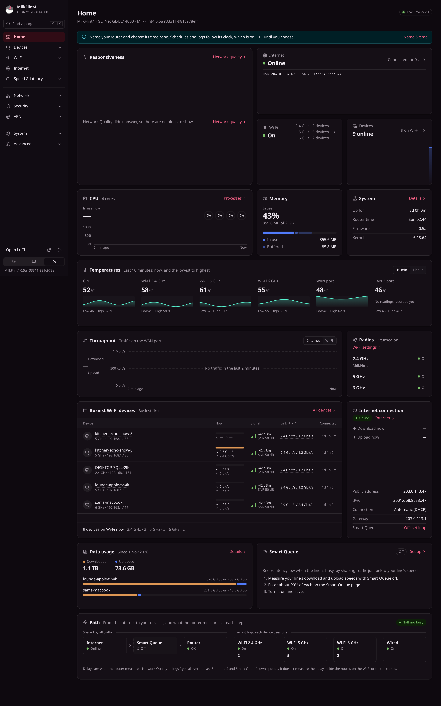

<p align="center">
  
</p>

<h1 align="center">MilkFlint4</h1>

<p align="center">
  <strong>OpenWrt for the GL.iNet Flint 4</strong><br>
  <code>GL-BE14000</code> · MT7988A · <strong>kernel 6.18</strong> · Wi‑Fi 7 · 10G WAN
</p>

<p align="center">
  <a href="https://github.com/REFFIXX/MilkFlint4/releases"></a>
  <a href="https://github.com/REFFIXX/MilkFlint4/releases"></a>
  <a href="https://github.com/REFFIXX/MilkFlint4/releases"></a>
  <a href="https://github.com/REFFIXX/MilkFlint4/releases"></a>
  <a href="https://openwrt.org"></a>
</p>

<p align="center">
  Soft milk panels · pink / cyan / green accents · Footstrap LuCI to match<br>
  <sub>Default theme: <b>Monokai milk</b> · Honey milk stays one click away</sub>
</p>

---

**MilkFlint4 1.0.1** is MilkFlint for the Flint 4: everyday UI, Smart Queue (CAKE), WireGuard, AdGuard Home, banIP, guest Wi‑Fi, device control, and Performance Tuning — on **OpenWrt main / kernel 6.18**, with MT7988 / MT7996 / YT9224 / RTL8261C wired in properly. The front-panel LCD shows the MilkFlint4 logo after boot.

Userspace includes OddBlueDog [**MilkFlint 0.87a**](https://github.com/OddBlueDog/openwrt/releases/tag/milkflint-0.87a) (VPN DNS, 1 Gbit CAKE threshold, queue-per-CPU IFBs). Flint 2–only and kernel **6.12** driver bits stay out; our board, WED, RSS, and theme stay in.

Keep a stock GL.iNet recovery image before you flash.

## Screenshots

<p align="center">
  
</p>

<p align="center">
  
</p>

<p align="center">
  
  &nbsp;
  
</p>

<p align="center">
  
  &nbsp;
  
</p>

More: [`milkflint/docs/forum/`](milkflint/docs/forum/).

## Install

Flash **only** this from [Releases](https://github.com/REFFIXX/MilkFlint4/releases):

```text
milkflint4-*-glinet_gl-be14000-squashfs-sysupgrade.bin
```

Do **not** use a factory / preloader image with GL.iNet recovery — leave the stock bootloader alone.

### From GL.iNet stock

```sh
scp -O milkflint4-*-glinet_gl-be14000-squashfs-sysupgrade.bin root@192.168.8.1:/tmp/
ssh root@192.168.8.1
cat /tmp/sysinfo/board_name    # must print: glinet,gl-be14000
sysupgrade -T /tmp/milkflint4-*-glinet_gl-be14000-squashfs-sysupgrade.bin
sysupgrade -n /tmp/milkflint4-*-glinet_gl-be14000-squashfs-sysupgrade.bin
```

SSH drops mid-flash — wait **3–5 minutes**. Or **System → Upgrade → Local Upgrade** with Keep Settings **off**.

### From OpenWrt / MilkFlint4

```sh
sysupgrade -n /tmp/milkflint4-*-glinet_gl-be14000-squashfs-sysupgrade.bin
```

First MilkFlint4 flash: don’t keep settings. Later MilkFlint4 → MilkFlint4: keep settings is fine.

### First boot

1. Cable into any `lan2`–`lan9`  
2. `http://192.168.1.1` — empty password → set one under **Admin Password**  
3. Wi‑Fi country defaults to **US** (6 GHz LPI). Use **WPA3** on 6 GHz  
4. WED is on by default; turn on firewall hardware flow offloading when you want Wi‑Fi ↔ WAN off the CPU  

### Back to stock

Reset + power-on → recovery at `http://192.168.1.1` (PC at `192.168.1.2/24`) → vendor image from [dl.gl-inet.com](https://dl.gl-inet.com/).

## Ports & hardware

| Role | Interface |
|---|---|
| WAN (10G RJ45) | `wan` |
| LAN | `lan2`–`lan5` (2.5G) · `lan6`–`lan9` (1G) · `sfp` (SFP+) |

| | |
|---|---|
| SoC | MT7988A (4× A73) · **kernel 6.18** |
| RAM / flash | 2 GB DDR4 / eMMC |
| Wi‑Fi | MT7996 tri‑band Wi‑Fi 7 |
| Switch / PHY | YT9224 + YT8824 · RTL8261C/D 10G WAN |
| Panel / fan | ST7789 + CST3530 · PWM from ~45 °C |
| Console | `ttyS0` 115200 8N1 |

## What’s in the image

| | |
|---|---|
| **UI** | Dashboard, Wi‑Fi, guests, DNS, AdGuard Home, banIP, SQM, VPN, schedules, device control, themes, upgrade, Performance Tuning — LuCI under **Advanced** |
| **Theme** | **Monokai milk** default (pink / cyan / green on soft milk). Honey milk available. LuCI Footstrap matches |
| **0.87a userspace** | VPN **Use VPN’s DNS** · multi-queue CAKE from **1 Gbit** Ethernet / **500 Mbit** PPPoE · queue-per-CPU IFBs · Test Bench delay / stalled · CAKE ECN/DSCP retry |
| **Steering** | Hardware **RSS** on `wan` (PDMA 0–3) |
| **SQM** | Multi-queue CAKE on by default on Flint 4; per-host fairness; egress single CAKE on `mtk_soc_eth` |
| **Wi‑Fi** | UL MU-MIMO/OFDMA **off** by default · US country · 6 GHz PSC **37** · BE latency tweak on 5+6 GHz |
| **WED** | `mt7996e wed_enable=Y` by default |
| **kmods** | Full `CONFIG_ALL_KMODS` — do **not** pull snapshot `kmod-*` from downloads.openwrt.org |

### Performance defaults

CPU `performance` · RSS forced · RX coalesce 20 µs · software + hardware flow offload + WED · large TCP buffers · high conntrack — seeded once by `99-milkflint4-flint4-perf`. Change later under **Performance Tuning**; edits stick.

### 1.0.1 highlights

- **Front-panel LCD splash** — MilkFlint4 logo stays on after boot  
- Everything from **1.0**: Flint 4 / kernel 6.18, Monokai milk, full 0.87a userspace, muru fix  

Notes: [`docs/RELEASE-1.0.1.md`](docs/RELEASE-1.0.1.md) · [`docs/RELEASE-1.0.md`](docs/RELEASE-1.0.md) · [`docs/RELEASE-0.9.md`](docs/RELEASE-0.9.md)

### 10G WAN (openwrt#26690 / #26691)

Firmware load + soft-reset before attach, USXGMII flap skip, MDIO 2.5 MHz, `eee-broken-*`, fan trip, WAN hotplug recovery. After a hard PHY wedge, **power-cycle** (warm reboot is not enough).

## Build

```bash
git clone https://github.com/REFFIXX/MilkFlint4.git
cd MilkFlint4
./scripts/feeds update -a && ./scripts/feeds install -a
cp milkflint/diffconfig .config && make defconfig
make download && make -j$(nproc)
```

```text
bin/targets/mediatek/filogic/milkflint4-*-glinet_gl-be14000-squashfs-sysupgrade.bin
```

UI (Node **24** + pnpm **12**):

```bash
cd milkflint/ui && pnpm install && pnpm exec vite build && node scripts/package.ts
```

| Path | Role |
|---|---|
| `target/linux/mediatek/` | BE14000 DTS, 6.18 patches, board defaults |
| `package/milkflint/` | UI + MilkFlint packages |
| `milkflint/ui/` | React source (Monokai milk default) |
| `milkflint/diffconfig` | Build seed |

## Support

* [Releases](https://github.com/REFFIXX/MilkFlint4/releases)  
* [OpenWrt Forum](https://forum.openwrt.org)  
* Upstream: [OpenWrt](https://openwrt.org) · [OddBlueDog MilkFlint](https://github.com/OddBlueDog/openwrt)

## License

GPL-2.0 as OpenWrt / MilkFlint — see `COPYING` and `LICENSES/`.
