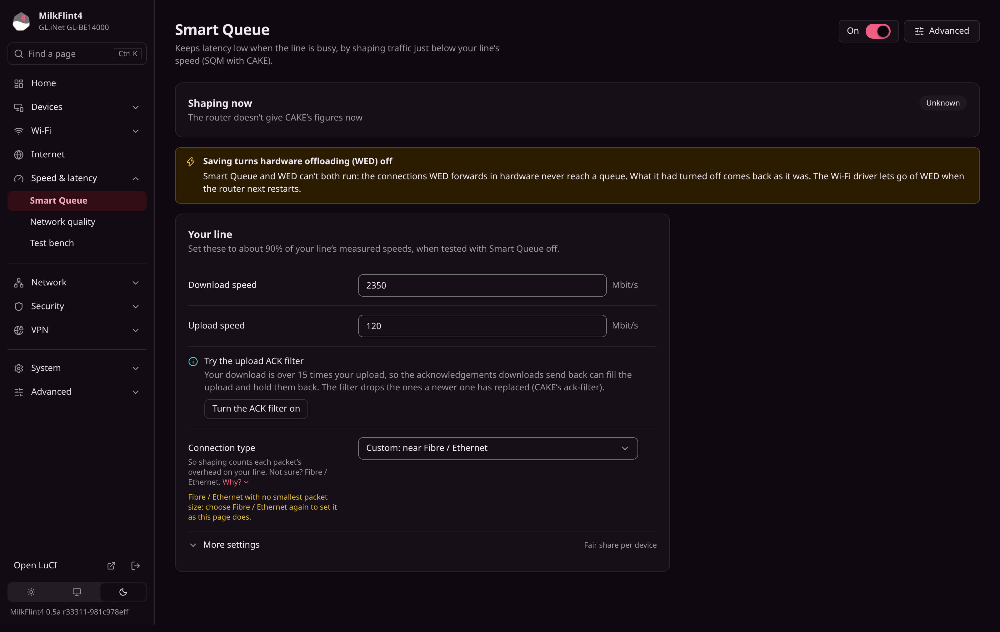

<p align="center">
  
</p>

<h1 align="center">MilkFlint4</h1>

<p align="center">
  <strong>OpenWrt that actually <em>feels</em> like a Flint 4</strong><br>
  <code>GL-BE14000</code> · MT7988A · <strong>kernel 6.18</strong> · Wi‑Fi 7 · 10G WAN · LCD that isn’t a blank stare
</p>

<p align="center">
  <a href="https://github.com/REFFIXX/MilkFlint4/releases"></a>
  <a href="https://github.com/REFFIXX/MilkFlint4/releases"></a>
  <a href="https://github.com/REFFIXX/MilkFlint4/releases"></a>
  <a href="https://github.com/REFFIXX/MilkFlint4/releases"></a>
  <a href="https://openwrt.org"></a>
</p>

<p align="center">
  Soft milk panels · pink / cyan / green accents · Footstrap LuCI to match<br>
  <sub>Default theme: <b>Monokai milk</b> · Honey milk stays one click away · pink <b>4</b> on the front panel after boot</sub>
</p>

---

If you’ve been waiting for OpenWrt on the **GL-BE14000** that doesn’t treat the box like a generic MT7988 brick — this is it.

**MilkFlint4 1.0.1** is everyday MilkFlint on Flint 4: dashboard, Wi‑Fi, guests, DNS, AdGuard Home, banIP, SQM, WireGuard, schedules, device control, themes, upgrade, Performance Tuning — on **OpenWrt main / kernel 6.18**, with MT7988 / MT7996 / YT9224 / RTL8261C wired in properly. The front-panel LCD lights up with the MilkFlint4 logo and **stays on**.

Userspace includes OddBlueDog [**MilkFlint 0.87a**](https://github.com/OddBlueDog/openwrt/releases/tag/milkflint-0.87a) guts (VPN DNS, 1 Gbit CAKE threshold, queue-per-CPU IFBs). Flint 2–only and kernel **6.12** driver bits stay out. The look is ours: **Monokai milk** (plus Honey milk), Footstrap LuCI to match, Flint 4 board/WED/RSS, and the LCD splash.

Keep a stock GL.iNet recovery image before you flash. Then grab a release, flash it, watch the pink **4** light up, and go break a speed test.

## Screenshots

<p align="center">
  
</p>

<p align="center">
  
  &nbsp;
  
</p>

<p align="center">
  
  &nbsp;
  
</p>

More (incl. light variants): [`milkflint/docs/forum/`](milkflint/docs/forum/).

## Why it’s spicy

### Hardware that actually works

Not “it boots.” *Wired in properly.*

| Piece | What’s going on |
|---|---|
| **10G WAN (RTL8261C)** | Firmware load, soft-reset, USXGMII flap skip, MDIO 2.5 MHz, `eee-broken-*`, hotplug recovery |
| **WAN path** | Real `wan` — not Flint 2 `ports` / `eth1` cargo-cult |
| **Wi‑Fi 7 (MT7996)** | Tri-band · **WED** on by default (`mt7996e wed_enable=Y`) |
| **RSS** | Hardware RSS on `wan` (PDMA 0–3) |
| **Panel** | ST7789 + CST3530 — lit, driven, branded (logo stays after boot) |
| **Fan** | PWM from ~45 °C |
| **Switch / PHY** | YT9224 + YT8824 · SFP+ present |

After a hard 10G PHY wedge: **power-cycle** (warm reboot is not enough). Upstream refs: openwrt#26690 / #26691.

### Ports

| Role | Interface |
|---|---|
| WAN (10G RJ45) | `wan` |
| LAN | `lan2`–`lan5` (2.5G) · `lan6`–`lan9` (1G) · `sfp` (SFP+) |

| | |
|---|---|
| SoC | MT7988A (4× A73) · **kernel 6.18** |
| RAM / flash | 2 GB DDR4 / eMMC |
| Wi‑Fi | MT7996 tri‑band Wi‑Fi 7 |
| Switch / PHY | YT9224 + YT8824 · RTL8261C/D 10G WAN |
| Panel / fan | ST7789 + CST3530 · PWM from ~45 °C |
| Console | `ttyS0` 115200 8N1 |

### What’s in the image

| | |
|---|---|
| **UI** | Dashboard, Wi‑Fi, guests, DNS, AdGuard Home, banIP, SQM, VPN, schedules, device control, themes, upgrade, Performance Tuning — LuCI under **Advanced** |
| **Theme** | **Monokai milk** default (pink / cyan / green on soft milk). Honey milk available. LuCI Footstrap matches |
| **LCD** | Boot splash paints the MilkFlint4 logo on the 320×240 panel and leaves it on |
| **0.87a userspace** | VPN **Use VPN’s DNS** · multi-queue CAKE from **1 Gbit** Ethernet / **500 Mbit** PPPoE · queue-per-CPU IFBs · Test Bench delay / stalled · CAKE ECN/DSCP retry |
| **Steering** | Hardware **RSS** on `wan` (PDMA 0–3) |
| **SQM** | Multi-queue CAKE on by default; per-host fairness; egress single CAKE on `mtk_soc_eth` |
| **Wi‑Fi** | UL MU-MIMO/OFDMA **off** by default (latency-first) · US country · 6 GHz PSC **37** · BE latency tweak on 5+6 GHz |
| **WED** | `mt7996e wed_enable=Y` by default |
| **kmods** | Full `CONFIG_ALL_KMODS` — do **not** pull snapshot `kmod-*` from downloads.openwrt.org |

### Performance defaults

CPU `performance` · RSS forced · RX coalesce 20 µs · software + hardware flow offload + WED · large TCP buffers · high conntrack — seeded once by `99-milkflint4-flint4-perf`. Change later under **Performance Tuning**; edits stick.

### What this is *not*

- Not stock GL.iNet UI / cloud stack  
- Not Flint 2 with the labels swapped  
- Not the OddBlueDog **6.12** kernel driver series — this is **6.18** + OpenWrt main cake_mq backports  

### 1.0.1

- **Front-panel LCD splash** — logo stays on after boot  
- Everything from **1.0**: stable Flint 4 / 6.18, Monokai milk, full 0.87a userspace, muru fix  

Notes: [`docs/RELEASE-1.0.1.md`](docs/RELEASE-1.0.1.md) · [`docs/RELEASE-1.0.md`](docs/RELEASE-1.0.md) · [`docs/RELEASE-0.9.md`](docs/RELEASE-0.9.md)

## Install

Flash **only** this from [Releases](https://github.com/REFFIXX/MilkFlint4/releases):

```text
milkflint4-*-glinet_gl-be14000-squashfs-sysupgrade.bin
```

Do **not** use a factory / preloader image with GL.iNet recovery — leave the stock bootloader alone.

### From GL.iNet stock

```sh
scp -O milkflint4-*-glinet_gl-be14000-squashfs-sysupgrade.bin root@192.168.8.1:/tmp/
ssh root@192.168.8.1
cat /tmp/sysinfo/board_name    # must print: glinet,gl-be14000
sysupgrade -T /tmp/milkflint4-*-glinet_gl-be14000-squashfs-sysupgrade.bin
sysupgrade -n /tmp/milkflint4-*-glinet_gl-be14000-squashfs-sysupgrade.bin
```

SSH drops mid-flash — wait **3–5 minutes**. Or **System → Upgrade → Local Upgrade** with Keep Settings **off**.

### From OpenWrt / MilkFlint4

```sh
sysupgrade -n /tmp/milkflint4-*-glinet_gl-be14000-squashfs-sysupgrade.bin
```

First MilkFlint4 flash: don’t keep settings. Later MilkFlint4 → MilkFlint4: keep settings is fine.

### First boot

1. Cable into any `lan2`–`lan9`  
2. `http://192.168.1.1` — empty password → set one under **Admin Password**  
3. Glance at the front panel — logo should be sitting there like it owns the place  
4. Wi‑Fi country defaults to **US** (6 GHz LPI). Use **WPA3** on 6 GHz  
5. WED is on by default; turn on firewall hardware flow offloading when you want Wi‑Fi ↔ WAN off the CPU  

### Back to stock

Reset + power-on → recovery at `http://192.168.1.1` (PC at `192.168.1.2/24`) → vendor image from [dl.gl-inet.com](https://dl.gl-inet.com/).

## Add OpenWrt 25.x access points

MilkFlint4 ships **Wi‑Fi roaming** (802.11r/k/v + `usteer`) and **802.11s mesh** (`mesh11sd`). Use other OpenWrt **25.12+** boxes as APs — same mobility domain for roaming, same mesh identity for backhaul.

1. Flash each AP with OpenWrt **25.12+** plus `mesh11sd` and full `wpad-mbedtls` (drop `wpad-basic-*`). Firmware Selector → customize packages, e.g. `-wpad-basic-mbedtls wpad-mbedtls mesh11sd ip-full vxlan`.
2. On the Flint 4 **Mesh** page, copy the **first-boot script** (same `auto_mesh_id` / gate SSID / key) and paste it into Firmware Selector’s “Script to run on first boot”, or run it once on a fresh AP.
3. One node with **WAN → ISP** = Main/portal (`portal_detect=1`). Other nodes = peers (WAN unplugged, or `portal_detect=5`).
4. On every AP SSID used for clients: match the **mobility domain** and enable 802.11r/k/v; run `usteer` (or rely on the MilkFlint router + matching FT). Do **not** run dawn and usteer together.
5. Stuck? Check channel tracking, flip `auto_config` 0→1 after a confidence test, power-cycle the peer, and don’t hand-edit wireless/network while mesh11sd auto-config owns the mesh.

Roaming and Mesh live under **Wi‑Fi** in the MilkFlint UI. LuCI stays the escape hatch.

## Build

```bash
git clone https://github.com/REFFIXX/MilkFlint4.git
cd MilkFlint4
./scripts/feeds update -a && ./scripts/feeds install -a
cp milkflint/diffconfig .config && make defconfig
make download && make -j$(nproc) IGNORE_ERRORS='n m'
```

```text
bin/targets/mediatek/filogic/milkflint4-*-glinet_gl-be14000-squashfs-sysupgrade.bin
```

UI (Node **24** + pnpm **12**):

```bash
cd milkflint/ui && pnpm install && pnpm exec vite build && node scripts/package.ts
```

### Windows (WSL2)

Prefer **WSL2 Ubuntu 24.04** with the tree on **ext4** (`~/src/MilkFlint4`), never `/mnt/c/...`. Install the same apt set as CI (see [`.github/workflows/build-firmware.yml`](.github/workflows/build-firmware.yml)), then feeds → `cp milkflint/diffconfig .config` → `make defconfig` → `make -j$(nproc) world` with `IGNORE_ERRORS='n m'`. For UI-only iteration (seconds): `cd milkflint/ui && pnpm install && pnpm exec vite build`. Full notes: [`docs/DEV-WSL.md`](docs/DEV-WSL.md).

| Path | Role |
|---|---|
| `target/linux/mediatek/` | BE14000 DTS, 6.18 patches, board defaults |
| `package/milkflint/` | UI + MilkFlint packages (incl. LCD splash) |
| `milkflint/ui/` | React source (Monokai milk default) |
| `milkflint/diffconfig` | Build seed |

## Support

* [Releases](https://github.com/REFFIXX/MilkFlint4/releases)  
* [OpenWrt Forum](https://forum.openwrt.org)  
* Upstream: [OpenWrt](https://openwrt.org) · [OddBlueDog MilkFlint](https://github.com/OddBlueDog/openwrt)

## License

GPL-2.0 as OpenWrt / MilkFlint — see `COPYING` and `LICENSES/`.
