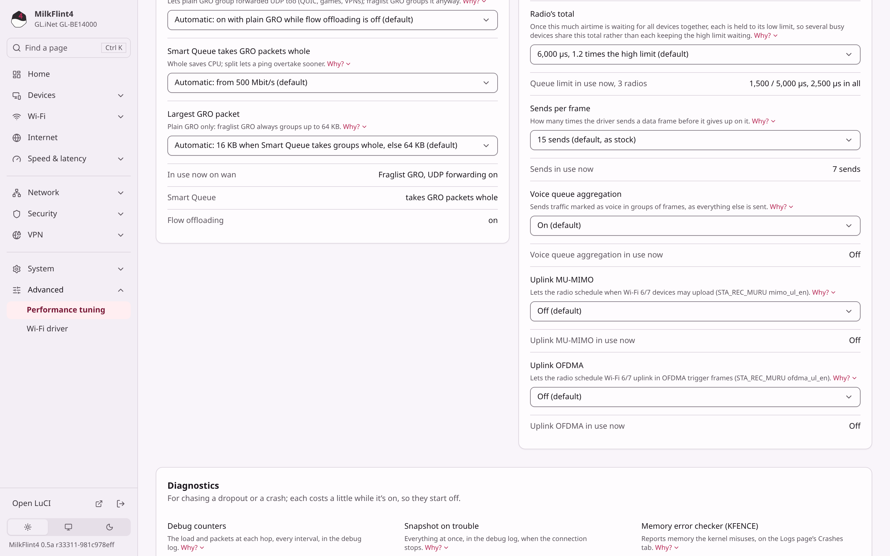
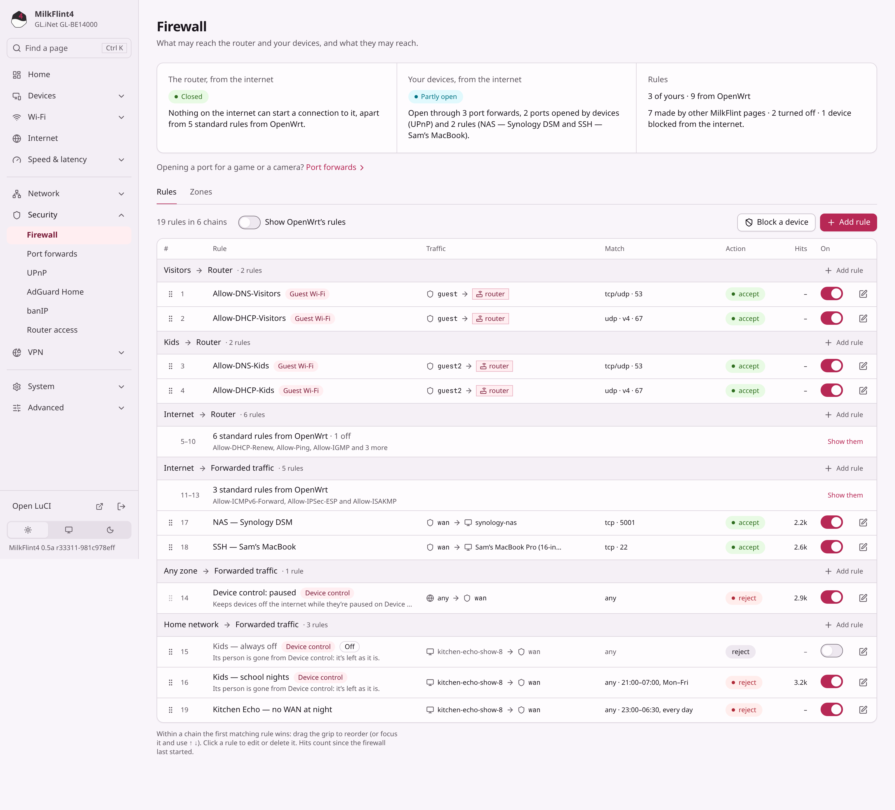
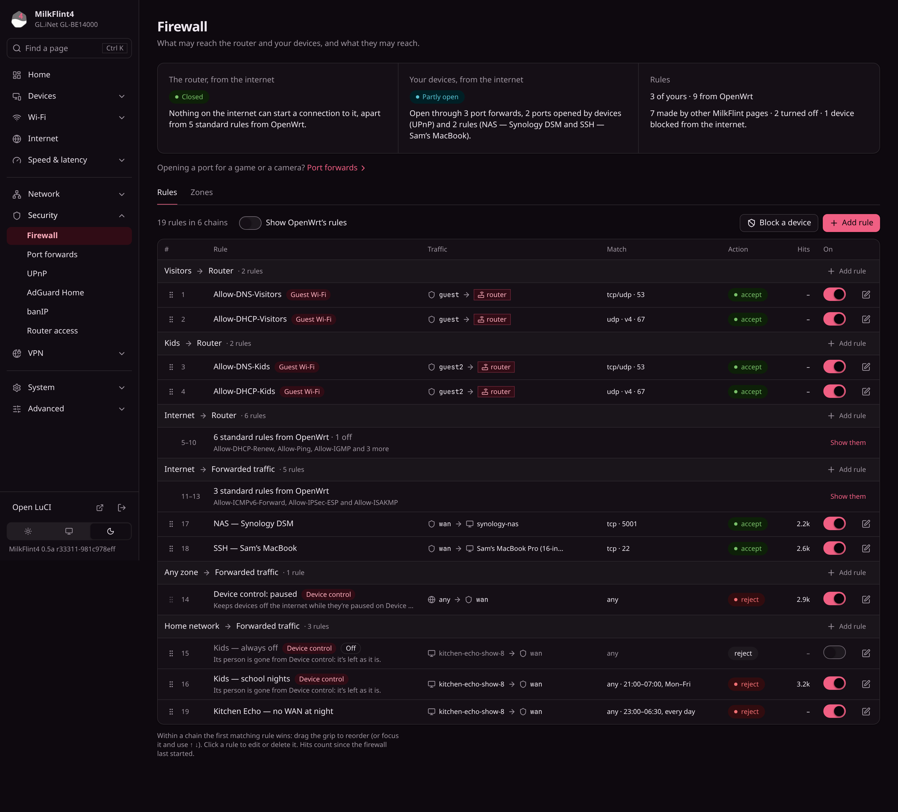
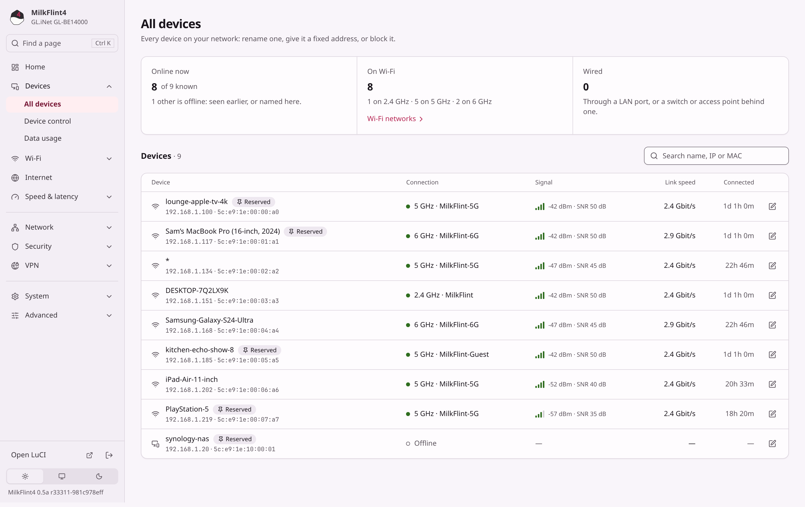
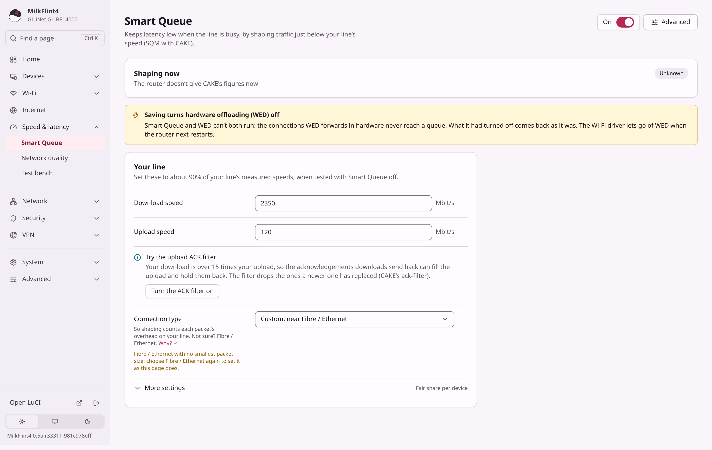

<p align="center">
  
</p>

<h1 align="center">MilkFlint4</h1>

<p align="center">
  <strong>OpenWrt for the GL.iNet Flint 4 (GL-BE14000)</strong><br>
  MediaTek MT7988A · <strong>kernel 6.18</strong> · Wi‑Fi 7 · 10G WAN · 2.5G LAN · SFP+ · front panel<br>
  MilkFlint’s everyday UI, tuned for Flint 4 hardware
</p>

<p align="center">
  <a href="https://github.com/REFFIXX/MilkFlint4/releases"></a>
  <a href="https://github.com/REFFIXX/MilkFlint4/releases"></a>
  <a href="https://github.com/REFFIXX/MilkFlint4/releases"></a>
  <a href="https://openwrt.org"></a>
</p>

---

**MilkFlint4 0.6a** runs **OpenWrt main / kernel 6.18** on the Flint 4 — full **RTL8261C/D** 10G PHY, hardware **RSS** on `wan`, default Wi‑Fi country **US** (6 GHz LPI + WPA3), uplink MU‑MIMO off by default, MT7988 **2.5G PHY firmware**, and **`CONFIG_ALL_KMODS`** so extras match this image’s vermagic (do not pull snapshot `kmod-*` from downloads.openwrt.org).

MilkFlint4 is MilkFlint, rebuilt for the **Flint 4**: the same dashboard, guest Wi‑Fi, AdGuard Home, banIP, Smart Queue (CAKE), WireGuard, themes, and Performance Tuning — wired to MT7988 / MT7996 / YT9224 instead of the Flint 2’s MT7986 stack.

Experimental alpha. Keep a stock GL.iNet recovery image before you flash.

## Screenshots

MilkFlint UI on a busy Flint 4, **Monokai milk** (default) — light and dark. Full pack: [`milkflint/docs/forum/`](milkflint/docs/forum/).

<p align="center">
  
</p>

<p align="center">
  
</p>

<p align="center">
  
  &nbsp;
  
</p>

<p align="center">
  
  &nbsp;
  
</p>

<p align="center">
  
  &nbsp;
  
</p>

<p align="center">
  
  &nbsp;
  
</p>

<p align="center">
  
  &nbsp;
  
</p>

## Install (sysupgrade)

Flash only this file from [Releases](https://github.com/REFFIXX/MilkFlint4/releases):

```text
milkflint4-*-glinet_gl-be14000-squashfs-sysupgrade.bin
```

That is the normal OpenWrt upgrade path. **Do not use the factory image** with GL.iNet’s upgrade UI or U‑Boot web recovery — they expect vendor metadata. Leave the stock bootloader alone.

### From GL.iNet stock firmware

1. Plug a PC into any LAN port. Admin/SSH is at `192.168.8.1`.
2. Copy the sysupgrade image, then flash with settings erased:

```sh
scp -O milkflint4-*-glinet_gl-be14000-squashfs-sysupgrade.bin root@192.168.8.1:/tmp/
ssh root@192.168.8.1
cat /tmp/sysinfo/board_name    # must print: glinet,gl-be14000
sysupgrade -T /tmp/milkflint4-*-glinet_gl-be14000-squashfs-sysupgrade.bin
sysupgrade -n /tmp/milkflint4-*-glinet_gl-be14000-squashfs-sysupgrade.bin
```

SSH drops mid-flash — wait **3–5 minutes**. Or use **System → Upgrade → Local Upgrade** with Keep Settings **off**.

### From OpenWrt / MilkFlint4

LuCI → **System → Backup / Flash Firmware**, Keep settings off on the first MilkFlint4 flash, or:

```sh
sysupgrade -n /tmp/milkflint4-*-glinet_gl-be14000-squashfs-sysupgrade.bin
```

Later MilkFlint4 → MilkFlint4 upgrades can keep settings.

### First boot

1. LAN cable into any `lan2`–`lan9` port  
2. Open `http://192.168.1.1` — empty password; set one under **Admin Password**  
3. Wi‑Fi country defaults to **US** (6 GHz LPI AP enabled via our regdb patch). Change it under Wi‑Fi if you need another region; use **WPA3** on 6 GHz  
4. Optional: **Performance Tuning → Hardware offloading (WED)** is on by default on Flint 4; enable firewall hardware flow offloading when you want Wi‑Fi ↔ WAN to leave the CPU  

### Back to stock GL.iNet

Hold **Reset** while powering on until the panel countdown, set the PC to `192.168.1.2/24`, open `http://192.168.1.1`, upload firmware from [dl.gl-inet.com](https://dl.gl-inet.com/). Recovery only accepts vendor images.

## Ports

| Role | Interface |
|---|---|
| WAN (10G RJ45) | `wan` |
| LAN | `lan2`–`lan5` (2.5G on YT9224) · `lan6`–`lan9` (1G) · `sfp` (SFP+ on LAN) |

MACs: factory eMMC `0x4000` (WAN label), LAN = WAN+2; Wi‑Fi bands from `0x4006`.

## Hardware

| | |
|---|---|
| SoC | MT7988A (4× Cortex‑A73) |
| Kernel | **6.18** (OpenWrt main mediatek/filogic) |
| RAM / storage | 2 GB DDR4 / eMMC |
| Wi‑Fi | MT7996 tri‑band Wi‑Fi 7 (2.4 / 5 / 6 GHz) |
| Switch | YT9224 DSA + YT8824 2.5G PHYs; RTL8261C/D-CG 10G WAN PHY |
| Panel | MIPI DBI (ST7789) + CST3530 touch |
| Cooling | PWM fan, SoC thermal trips (fan starts ~45 °C) |
| Console | `ttyS0` 115200 8N1 |

## MilkFlint carried over — Flint 4 focused

Everything below ships in the image. Generic MilkFlint behaviour is kept; defaults that touch radios, WED, or the switch are pointed at **MT7996 / MT7988 / YT9224**.

| Area | What you get on Flint 4 |
|---|---|
| **MilkFlint UI** | Dashboard, Wi‑Fi, guests, DNS, AdGuard Home, banIP, SQM, VPN, schedules, device control, themes, upgrade, Performance Tuning — LuCI under **Advanced** |
| **Theme** | Default **Monokai milk** (milky Monokai Pro: pink / cyan / green on soft milk panels). Honey milk stays available. LuCI Advanced uses Footstrap’s matching Monokai milk palette |
| **Upstream MilkFlint** | Includes OddBlueDog **MilkFlint 0.85a** (device control, crontab schedules, CAKE/Wi‑Fi fixes, AdGuard/ubus fixes) — Flint 2–only bits left aside; Flint 4 WED/Wi‑Fi/switch overlays on top |
| **uhttpd** | `milkflint.html` is the index page; UI assets under `/milkflint/` |
| **Packet steering** | Hardware **RSS** on `wan` (four PDMA rings / GIC 221–224), not software RPS — MilkFlint layout via `ports rss`; forced on in Flint 4 defaults |
| **Smart Queue** | Multi‑queue CAKE on by default for Flint 4; ingress `cake_mq` + `no-split-gso` on multi‑gig WAN; per‑host fairness (`nat dual-dsthost` / `dual-srchost`); egress stays single CAKE on `mtk_soc_eth` |
| **Max performance** | See **MilkFlint4 performance defaults** below — conntrack, TCP buffers, netdev budget, CPU `performance`, flow offload + WED |
| **Wi‑Fi latency** | 5 GHz + **6 GHz** best‑effort TXOP/backoff tweak; MU EDCA timers shortened; DTIM 1; airtime fairness ready (off until enabled) |
| **Country** | Default **US** on first boot; 6 GHz LPI AP allowed (regdb patch drops US `NO-IR`) |
| **6 GHz** | Default PSC channel **37** instead of `auto` (avoids 5+6 GHz MLD ACS deadlock) |
| **WED** | `mt7996e wed_enable=Y` by default; flowtable hotplug when radios appear |
| **Stealth / ping** | WAN ping off and related firewall defaults from MilkFlint |
| **Front panel** | MIPI DBI panel firmware + CST3530 touch |
| **Fan** | PWM fan with earlier low trip so the 10G PHY stays cooler |
| **kmods** | Full `CONFIG_ALL_KMODS` set built with this image’s vermagic — install extras from the MilkFlint4 package feed, not downloads.openwrt.org |

### MilkFlint4 performance defaults (Flint 4)

Keeps every original MilkFlint Performance Tuning path (WED, AQL, steering UI, CAKE knobs, GRO), then adds board defaults tuned for **MT7988A + 2 GB + 10G WAN + Wi‑Fi 7**:

| Knob | Default on first boot |
|---|---|
| **CPU** | `performance` governor on all four A73s (fan + 45 °C trip handle heat) |
| **Packet steering** | MilkFlint **RSS** forced (`milkflint.steering.rss=1`); realtime NAPI rings; Wi‑Fi workers spread |
| **RX coalesce** | `rx_delay=20` µs when unset |
| **Flow offload** | Firewall software + **hardware** flow offloading on; WED on (`mt7996e`) |
| **Conntrack** | `nf_conntrack_max=262144` / `buckets=65536` |
| **TCP / sockets** | Large `rmem`/`wmem` (16 MiB cap), `somaxconn=4096`, `tcp_max_syn_backlog=8192`, `tcp_fastopen=3`, `tcp_slow_start_after_idle=0`, `tcp_mtu_probing=1` |
| **Netdev** | `netdev_max_backlog=5000`, `netdev_budget=600` / `8000` µs |
| **Neigh** | Higher IPv4/IPv6 `gc_thresh` for dense Wi‑Fi client tables |
| **VM** | `swappiness=0`, milder `vfs_cache_pressure` |

Applied by `99-milkflint4-flint4-perf` (once; clear `milkflint.defaults.flint4_perf` to re-seed), `/etc/sysctl.d/22-milkflint4-be14000.conf`, and `milkflint4-perf` at boot. Change anything later under **Performance Tuning** / LuCI — those edits stick.

### What’s new in 0.6a

- **`mt7988-2p5g-phy-firmware`** on the BE14000 image (clears boot `i2p5ge-phy-pmb.bin` miss; matches OpenWrt main packaging intent)
- **Uplink MU‑MIMO / OFDMA** pinned off in Flint 4 Wi‑Fi uci-defaults (Tuning can still opt in)
- **openwrt#26690** hardening: ieee80211 hotplug fan-pulse when a second radio appears (plus existing WAN flap recovery)
- Keeps MilkFlint4 DTS mitigations vs upstream snapshot: MDIO 2.5 MHz, `eee-broken-*`, longer PHY reset, 45 °C fan trip, active-low panel reset

### What’s new in 0.5a

- **Uplink MU‑MIMO off by default** (OddBlueDog): clears `mimo_ul_en` that caused ~65–300 ms best‑effort Wi‑Fi pauses; Tuning switches for uplink MU‑MIMO / OFDMA
- **SQM** remaps stock `eth1` → `wan` so multi‑gig CAKE defaults apply on BE14000
- **WED** seeds on first boot (preinit) so `mt7996e` loads with `wed_enable=Y` without a second reboot
- US country / Upgrade URL / BE14000 keep‑settings / `mt7996e` log+IRQ fixes

### Flint 4 kernel / board fixes (since 0.3a)

Moved mediatek/filogic to **kernel 6.18** (OpenWrt main stack) for best Flint 4 performance:

- **Kernel 6.18** — OpenWrt main `backport` / `hack` / `pending` + mediatek `patches-6.18`, including full **RTL8261C/D-CG** Realtek PHY support + `rtl8261c` / `rtl826x` firmware
- **Upstream BE14000 DTS** — `wan` netdev name, `yt922x_4b` DSA tag, `mediatek,force-fixed-10g`, MIPI panel, CST3530
- **Hardware RSS (MT7988)** — 6.18 `mt7988a.dtsi` already exposes `pdma0`–`pdma3`; MilkFlint 990-series (refreshed for 6.18 eth API) enables `MTK_PDMA_INT \| MTK_RSS` on MT7988
- **YT9224 mdi-swap / USXGMII PCS flap skip** — from OpenWrt main (975/978 + 967-54)
- **US 6 GHz LPI** — wireless-regdb patch so US AP mode is not blocked by `NO-IR`
- **SQM / CAKE** — OpenWrt main `cake_mq` backports (`backport-6.18` 700-*/701-*) + MilkFlint sync_time hack (`hack-6.18` 710-*)
- **ALL_KMODS** — extras match this build (official snapshot kmods will not load)

### 10G WAN mitigations (openwrt#26690 / #26691)

MilkFlint4 ships board + driver workarounds for the RTL8261C/D issues still open upstream:

- **#26691 (empty PMA / `-EINVAL` on cold boot)** — `rtl8261x_get_features` loads firmware early (before `config_init`), soft-resets and re-reads abilities up to 5×, and fails the probe instead of attaching a blank PHY; longer PHY reset deassert in DTS.
- **#26690 (WAN flaps / wedges when a second radio comes up)** — USXGMII PCS flap skip + RTL8261 SerDes reset (OpenWrt main), MDIO at 2.5 MHz, `eee-broken-*` on the WAN PHY, 45 °C fan trip, and a `wan` hotplug that pulses the fan + bounces the link on rapid multi-radio flaps (matches the recovery path reported upstream).

If WAN still misbehaves after a hard wedge, power-cycle the router (warm reboot is not enough once the PHY is stuck).

### Packages / kmods

**Do not install `kmod-*` from downloads.openwrt.org** into a MilkFlint4 image — vermagic will not match. That is true for any image whose kernel is not bit-identical to the official builder (RSS, US 6 GHz LPI, and the WAN PHY retry are kernel-side).

MilkFlint4 builds **`CONFIG_ALL_KMODS`** with this tree so extras match the image. The MilkFlint **UI and tweaks are userspace** (packages under `package/milkflint/`, board uci-defaults); they work on this image and can also be layered onto a stock OpenWrt main build if you prefer official kmods and accept losing MilkFlint’s kernel-side WAN/RSS/6 GHz bits.

## Build

Linux host with the [OpenWrt build system](https://openwrt.org/docs/guide-developer/build-system/install-buildsystem). Use **gcc** as the host compiler (not clang).

```bash
git clone https://github.com/REFFIXX/MilkFlint4.git
cd MilkFlint4
./scripts/feeds update -a
./scripts/feeds install -a
cp milkflint/diffconfig .config
make defconfig
make download
make -j$(nproc)
```

Image:

```text
bin/targets/mediatek/filogic/milkflint4-*-glinet_gl-be14000-squashfs-sysupgrade.bin
```

UI rebuild (Node **24.11** + pnpm):

```bash
cd milkflint/ui && pnpm install --frozen-lockfile --config.trust-policy=off && pnpm exec vite build && node scripts/package.ts
```

## Tree map

| Path | Role |
|---|---|
| `target/linux/mediatek/` | BE14000 DTS, 6.18 patches, board scripts, Flint 4 Wi‑Fi / SQM defaults |
| `target/linux/generic/*-6.18/` | OpenWrt main 6.18 backports (`cake_mq` 700-*/701-*) + MilkFlint CAKE sync hack (`710-*`) |
| `package/firmware/` | `rtl8261c-firmware`, `rtl826x-firmware`, MIPI DBI panel sequences |
| `package/milkflint/` | UI + MilkFlint packages (WED aware of `mt7996e`) |
| `milkflint/ui/` | React UI source |
| `milkflint/diffconfig` | Flint 4 build seed (`VERSION_DIST=MilkFlint4`, kernel 6.18, `ALL_KMODS`) |

Development is on **`main`**.

## Support

* [Releases](https://github.com/REFFIXX/MilkFlint4/releases) — flash the `…-sysupgrade.bin`
* [OpenWrt Forum](https://forum.openwrt.org) — good place for MilkFlint4 / Flint 4 discussion
* Upstream: [OpenWrt](https://openwrt.org) · [MilkFlint](https://github.com/OddBlueDog/MilkFlint)

## License

Same as OpenWrt / MilkFlint — GPL-2.0; see `COPYING` and `LICENSES/`.
