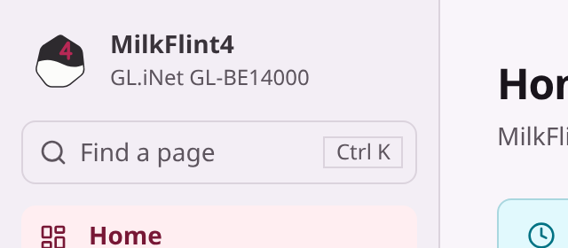
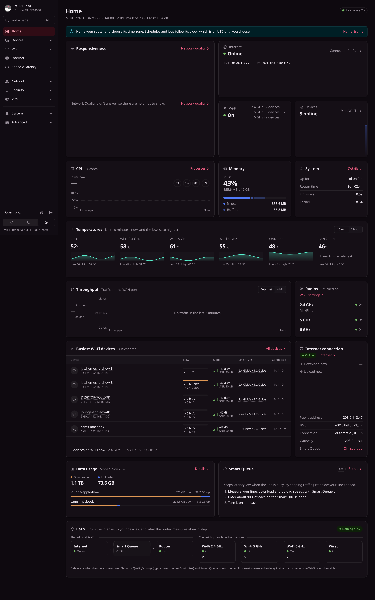
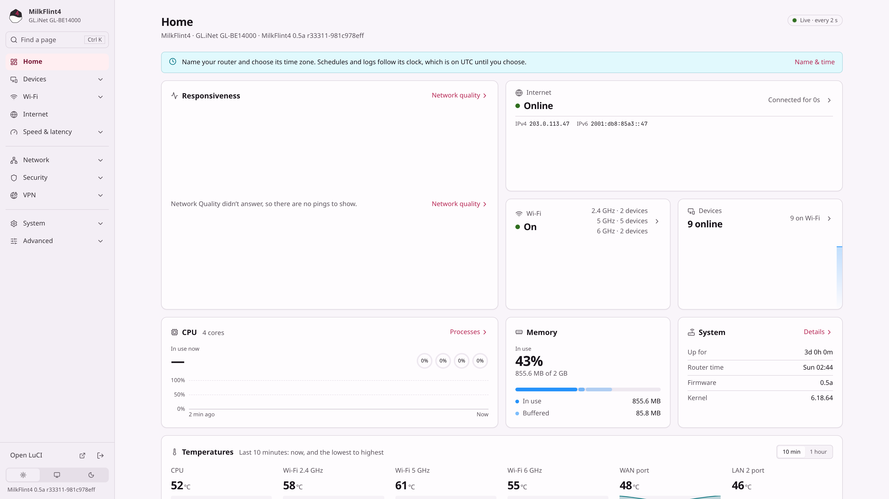
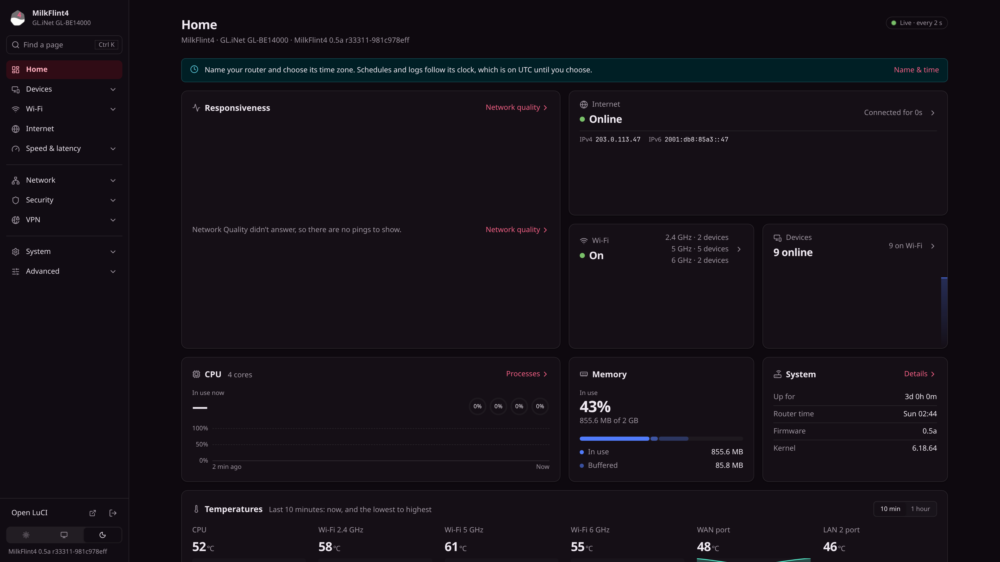
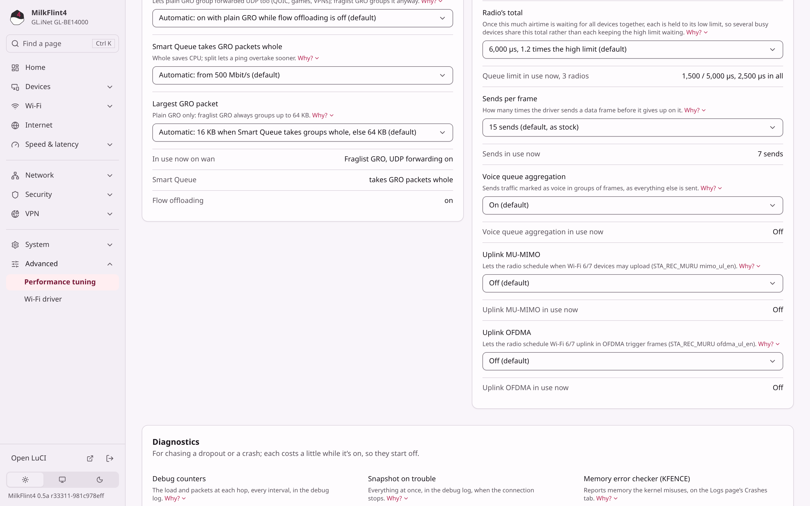
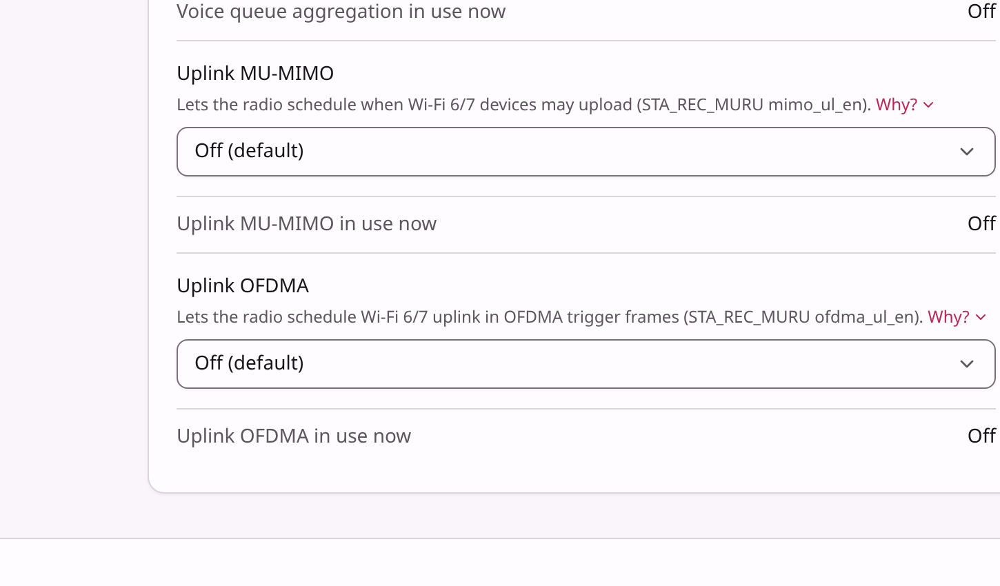
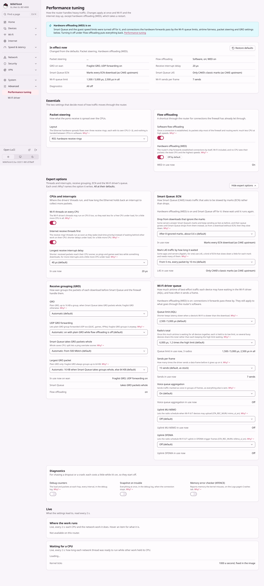
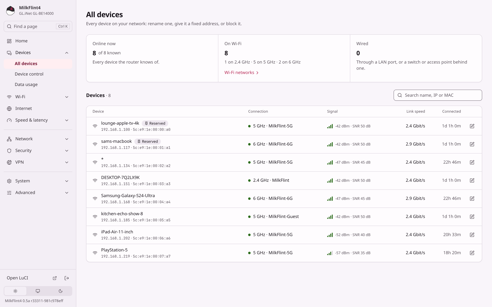
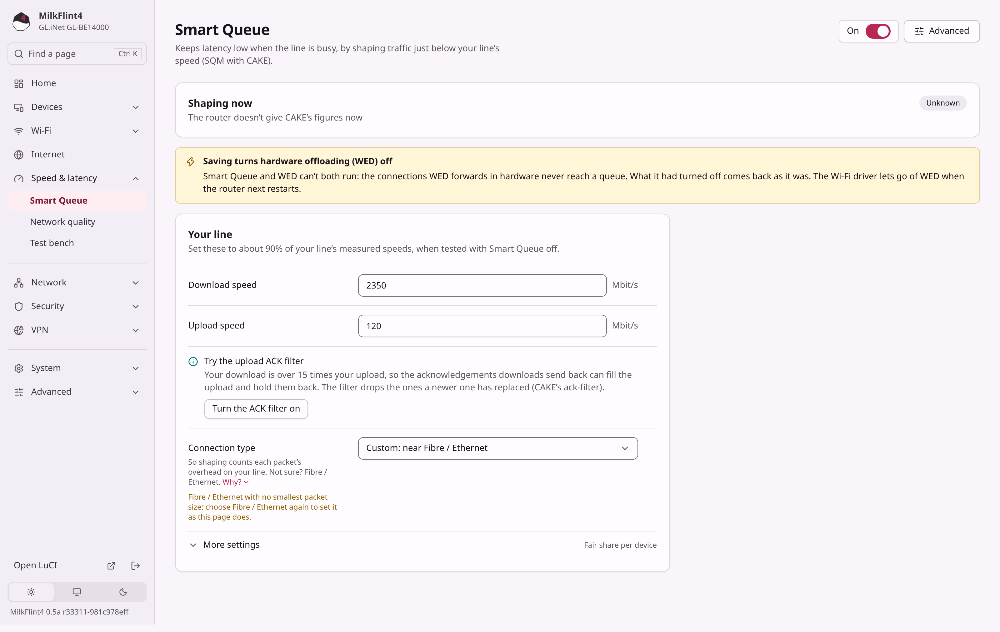
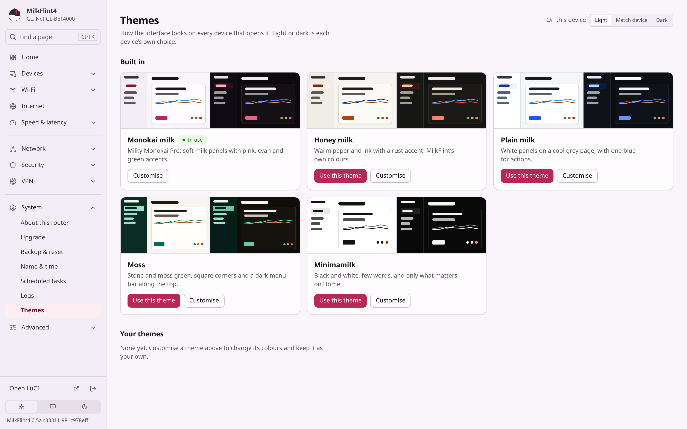

# MilkFlint4 0.5a — OpenWrt forum screenshots

Retina captures of the MilkFlint UI on a busy **GL-BE14000** mock, **Monokai milk** theme (charcoal flint / milk / pink `#ff6188`).

Regenerate from a packaged UI:

```bash
cd milkflint/ui
pnpm package
FORUM_SHOTS_OUT=/tmp/forum-shots node scripts/forum-screenshots.mjs
```

Then copy the `forum-*.png` files you want into this folder.

---

## Logo





## Home








## Wi-Fi (tri-band)


## Performance tuning (UL MU-MIMO Off)








## Devices / SQM / Themes






