# MilkFlint4 0.5a — OpenWrt forum screenshots

Retina captures of the MilkFlint UI on a busy **GL-BE14000** mock, **Monokai milk** (charcoal flint / milk / pink `#ff6188`). Light and dark for each page.

Regenerate:

```bash
cd milkflint/ui
pnpm package
FORUM_SHOTS_OUT=/tmp/forum-shots node scripts/forum-screenshots.mjs
```

---

## Logo

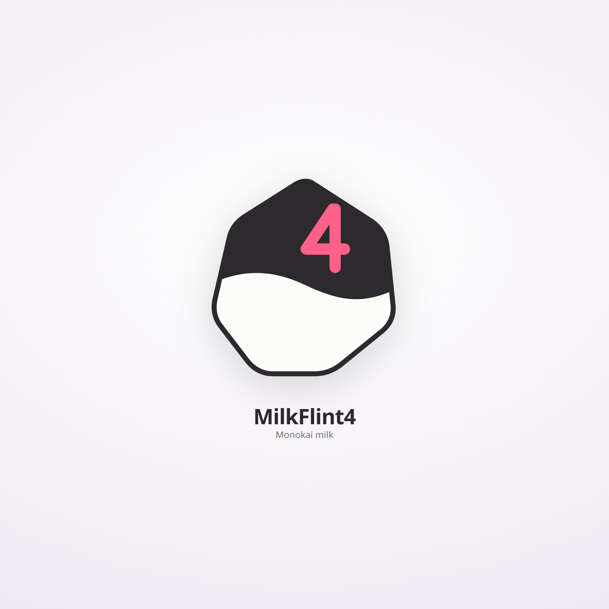

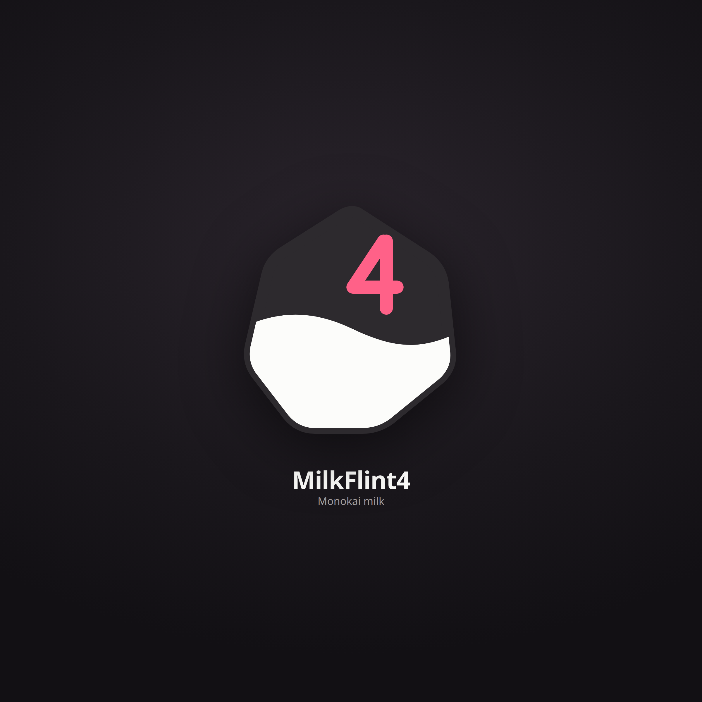

## Home

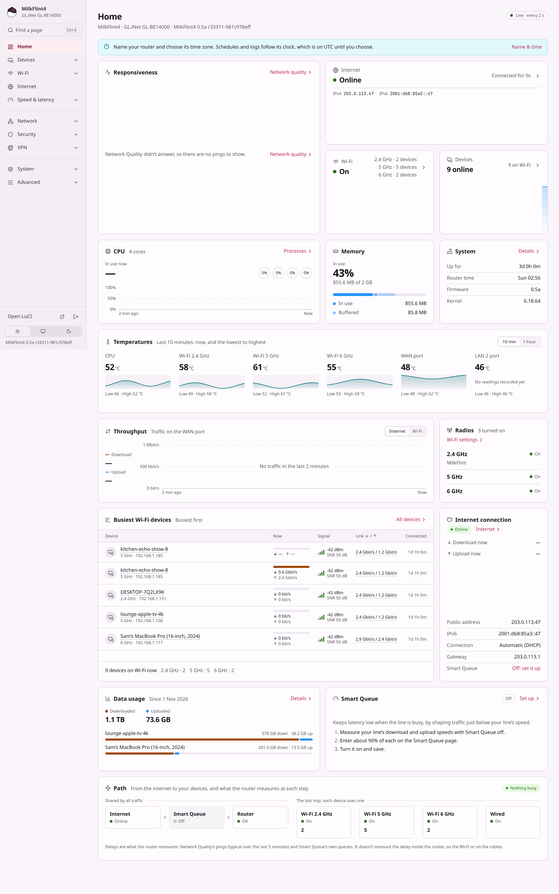


## Wi-Fi (tri-band)

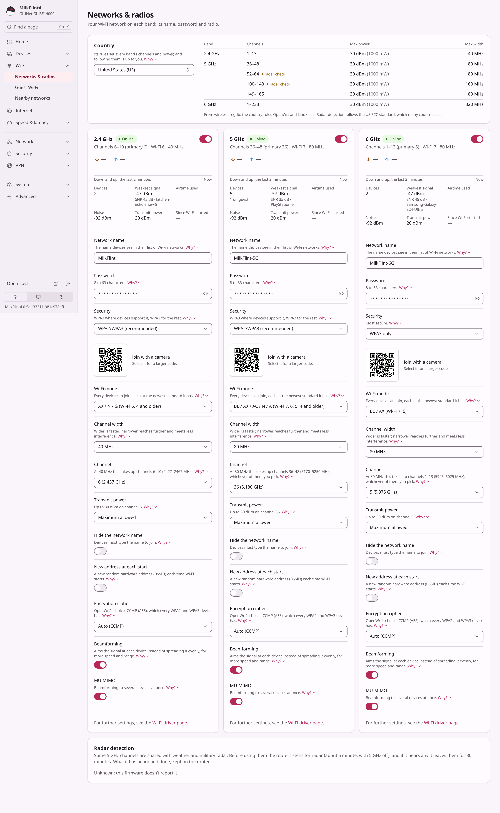

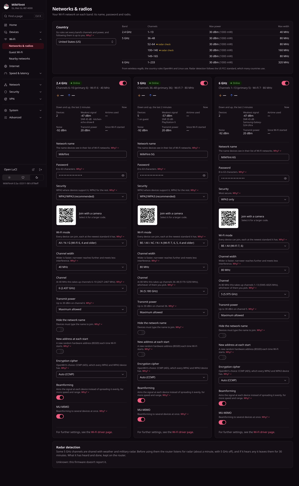

## Performance tuning (UL MU-MIMO Off)


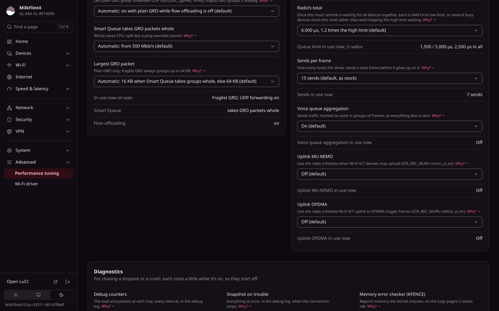

## Devices / SQM


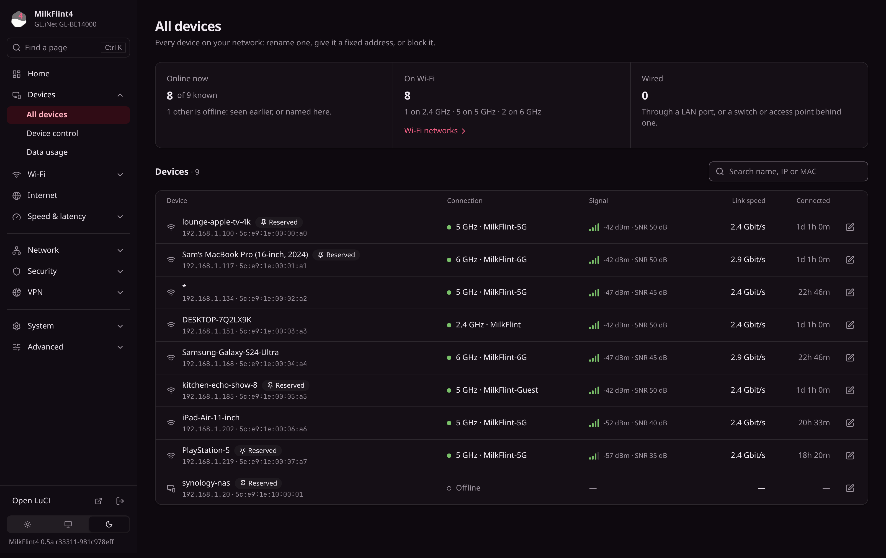


## Firewall


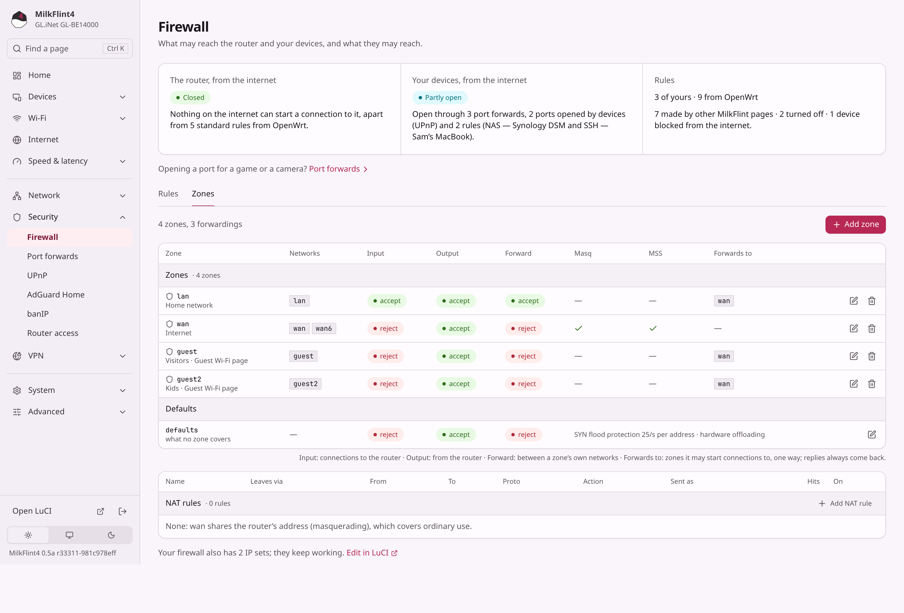

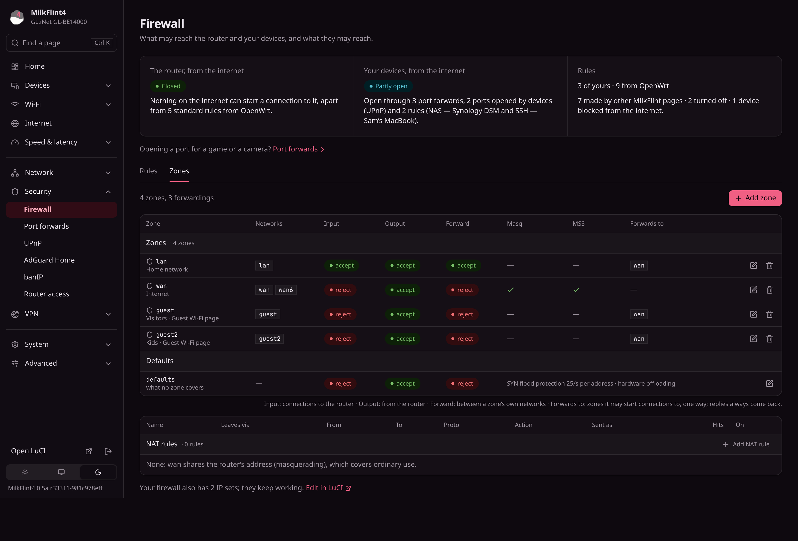

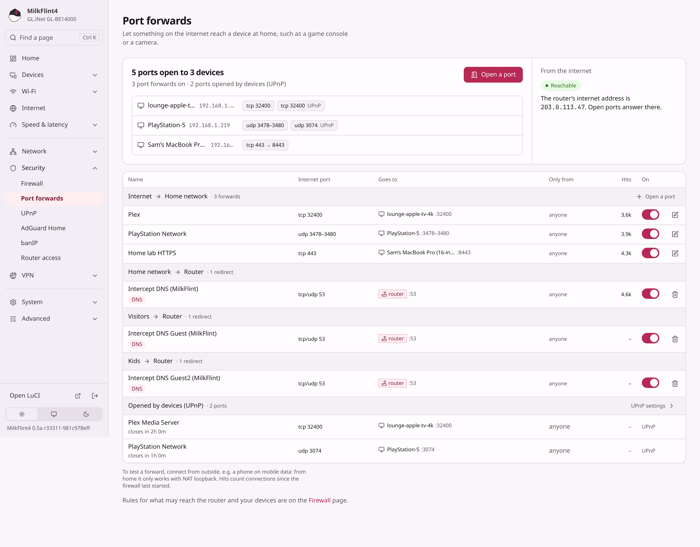

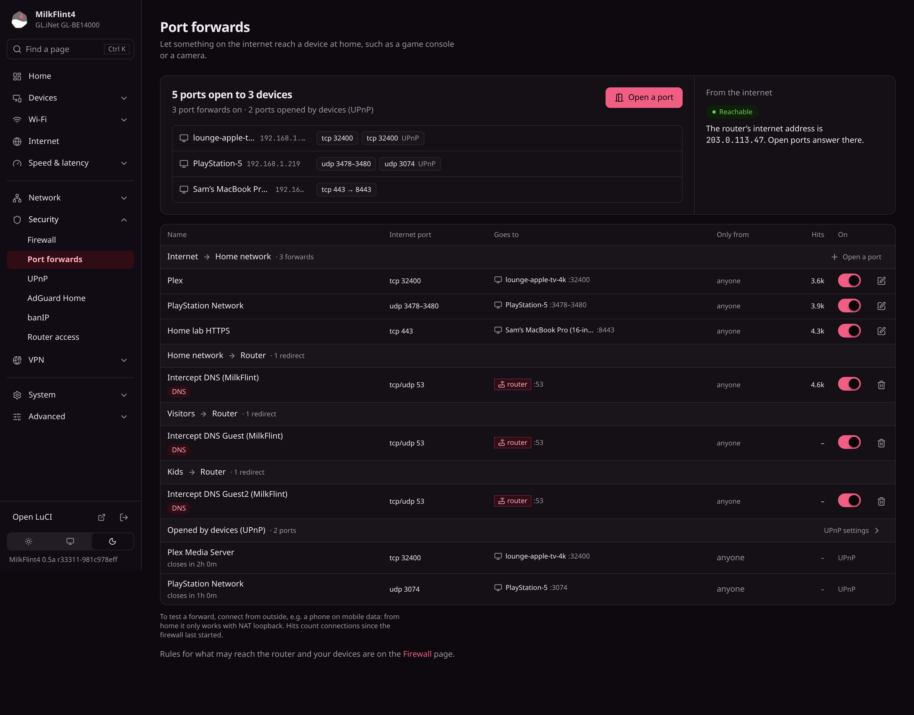

## Roaming / Mesh / Themes (README gallery)

Same-size **Monokai milk** dark cards used in the root README (Wi‑Fi roaming, Mesh, Themes, Home, …):

→ [`../readme/`](../readme/)
